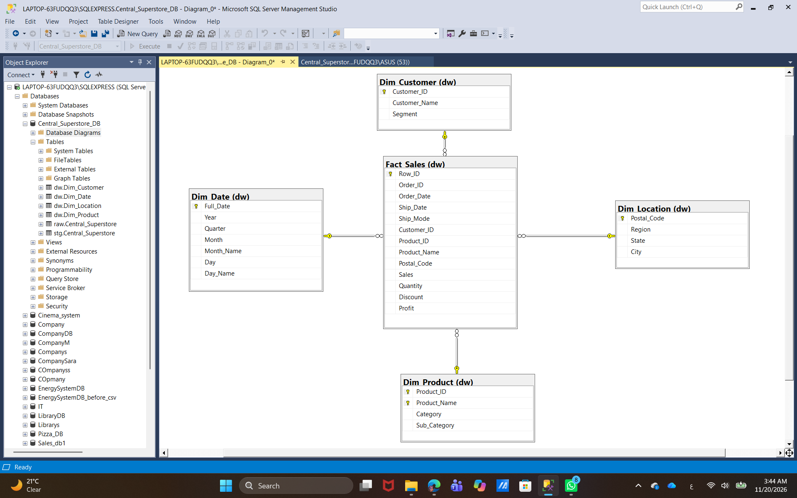

# Central Superstore – SQL Data Analysis

## 📌 Project Overview

This project focuses on analyzing the **Central Superstore** retail dataset using SQL Server to explore sales performance, profitability, customer behavior, and product trends.

The project involves database design, data preparation, SQL querying, and business analysis to transform raw retail data into meaningful insights that support data-driven decision-making.

## 🎯 Project Objectives

- Analyze overall sales and profitability.
- Explore customer purchasing behavior.
- Evaluate product and category performance.
- Identify sales trends over time.
- Examine geographical sales performance.
- Design a structured relational database.
- Extract actionable business insights using SQL.

## 🛠️ Tools & Technologies

- **SQL Server** – Database management and querying.
- **T-SQL** – Data preparation, validation, and analysis.
- **Relational Database Design** – Structuring tables and relationships.
- **Data Analysis** – Exploring business performance and trends.
- **GitHub** – Project documentation and version control.

## 🗄️ Database Design

The project uses SQL Server to create and manage a structured database for retail sales analysis.

The database schema organizes the data into related tables with defined relationships to support efficient querying and analysis.

### Database Schema Diagram

<p align="center">
  
</p>

## 🔍 SQL Analysis

The SQL script covers database creation, data preparation, validation, and analytical queries.

The analysis explores:

- **Sales Performance:** Total sales, orders, and sales trends.
- **Profitability Analysis:** Total profit, profit margins, and loss-making areas.
- **Customer Analysis:** Customer distribution and segment performance.
- **Product Analysis:** Product and category performance.
- **Time-Based Analysis:** Annual sales and profitability trends.
- **Geographical Analysis:** Sales performance across locations.
- **Data Validation:** Checking data quality and relationships.

## 📊 Key Performance Indicators (KPIs)

| KPI | Result |
|---|---:|
| Total Customers | 629 |
| Total Sales Records | 2,323 |
| Total Orders | 1,175 |
| Total Sales | $499,979.78 |
| Total Profit | $39,706.26 |
| Total Quantity Sold | 8,780 |
| Average Sales per Record | $215.23 |
| Average Profit per Record | $17.09 |
| Profit Margin | 7.94% |

## 💡 Key Business Insights

### 1. Sales & Profitability
- 2016 recorded the highest annual sales.
- 2015 achieved the highest annual profit and profit margin.
- Overall sales reached approximately $500K, generating $39.7K in profit.

### 2. Category Performance
- Technology was the strongest-performing category.
- Furniture recorded an overall loss, indicating a profitability concern that requires further investigation.

### 3. Subcategory Performance
- Copiers generated the highest profit among product subcategories.

### 4. Customer Segment Analysis
- The Consumer segment contributed the highest sales.
- However, it recorded the lowest profit margin among the customer segments.

### 5. Data Quality Observations
- Some records with zero sales were identified for further validation.
- Geographical results require careful interpretation because postal codes may not uniquely identify locations.

## 📁 Repository Structure

```text
Central-Superstore-SQL-Analysis/
│
├── Central_Superstore.csv
├── Central_Superstore_Business_Analysis_Insights.docx
├── Central_Superstore_DB.sql
├── Database_Schema_Diagram.png
└── README.md
```

## 📦 Project Files

| File | Description |
|---|---|
| `Central_Superstore.csv` | Original retail dataset used in the analysis |
| `Central_Superstore_DB.sql` | SQL Server database creation, data preparation, validation, and analytical queries |
| `Database_Schema_Diagram.png` | Visual representation of the database structure and relationships |
| `Central_Superstore_Business_Analysis_Insights.docx` | Business analysis report containing KPIs and key findings |

## 👩‍💻 Author

**Sara Raafat**

Business Information Systems Student | Aspiring Data Analyst

- [LinkedIn](https://www.linkedin.com/in/sarah-raafat-639a88259/)
- [GitHub](https://github.com/sararaafatmohamed-cmd)

---

*This project reflects my practical experience in SQL Server, relational database design, data analysis, and business intelligence.*
